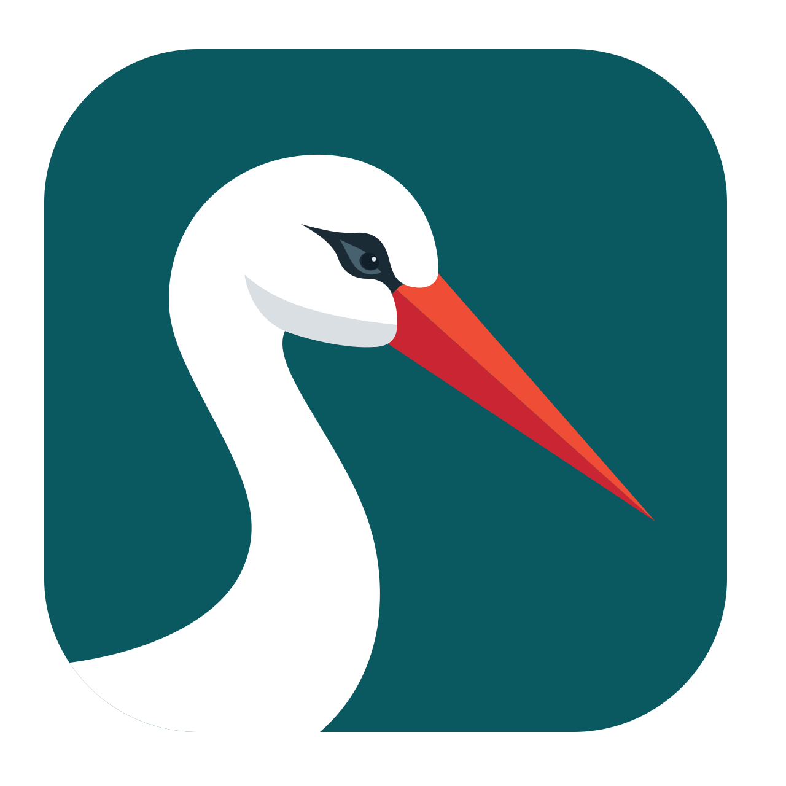

# Bociek — polski asystent dla Home Assistant

**Boćka tworzymy metodą vibe codingu z pomocą AI. Dotyczy to kodu, testów i dokumentacji.**

Bociek pozwala sterować domem w Assist tak, jak mówi się na co dzień. Gdy
w salonie powiesz „Zapal światło”, korzysta z lokalizacji satelity. Gdy
dodasz „w kuchni”, wybiera kuchnię. Zna nazwy i aliasy z Home Assistant,
a proste polecenia rozpoznaje lokalnie, bez LLM.

Możesz też powiedzieć „Odlicz dwie minuty”, zapytać „Czy gdzieś jest otwarte
okno?” lub „Jaka jest dziś pogoda?”. To, z czego możesz skorzystać, zależy
od urządzeń i integracji dostępnych w Twoim HA.

## Instalacja

W Home Assistant 2026.11.3 lub nowszym otwórz **Ustawienia → Marketplace → Dodaj z linku**
i wklej adres repozytorium Boćka. Po instalacji uruchom ponownie HA,
dodaj **HA Polish Context Voice** i wybierz go jako agenta rozmowy w polskim
profilu Assist.

[Instrukcja krok po kroku, instalacja ręczna i pierwsza próba](deployment/PIERWSZA-INSTALACJA.md).

## Rozwój

Najpierw dopracowujemy codzienne polecenia, wybór właściwego pokoju i krótkie
odpowiedzi. Więcej kontekstu ma sens wtedy, gdy podstawy działają przewidywalnie.

[Historia wersji](CHANGELOG.md) · [Licencja MIT](LICENSE).
